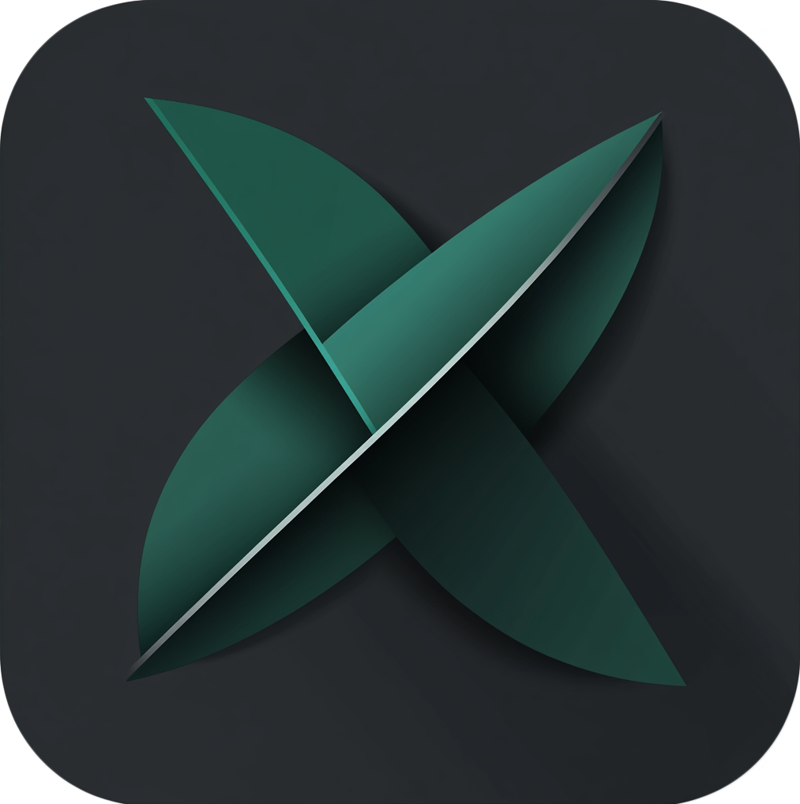
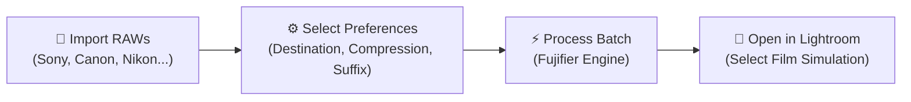

<p align="center">
  
</p>

<h1 align="center">FUJIFIER</h1>

<p align="center">
  <strong>Authentic Fujifilm Film Simulation Profiles for Any Camera RAW Photo</strong>
</p>

<p align="center">
  <a href="https://github.com/ip-web/Fujify/releases/latest"></a>
  <a href="https://github.com/ip-web/Fujify/actions/workflows/multiplatform.yml"></a>
  <a href="LICENSE"></a>
  
  
</p>

---

> *"After getting all my photography gear stolen and not having the funds and time to buy back into Fujifilm, I settled on buying used Sony gear. I immediately missed the Fuji film simulations which had become one of the pillars of my editing process. That's what motivated me to develop Fujifier — to bring that Fujifilm color science back to any camera's shots."*  
> — **Isidore Paulin**, Creator of Fujifier

---

## 🌟 What is Fujifier?

**Fujifier** unlocks authentic **Fujifilm Film Simulation color profiles** (including Classic Chrome, Classic Neg, Nostalgic Neg, Eterna, Reala Ace, Acros, and Velvia) for **any camera RAW file** inside Adobe Lightroom and Adobe Camera Raw (ACR).

Whether you shoot with **Sony, Canon, Nikon, Panasonic Lumix, Olympus/OM System, Leica, Pentax, or Hasselblad**, Fujifier converts your RAW files into DNG format with calibrated camera metadata and color matrix parameters recognized natively by Adobe Lightroom develop engines.

---

## 🚀 Key Features

### 🎨 20 Authentic Fujifilm Film Simulations
Unlock the full palette of modern Fujifilm camera profiles (based on the flagship Fujifilm X-T5 and GFX series):
- **Color Profiles**: PROVIA / Standard, Velvia / Vivid, ASTIA / Soft, CLASSIC CHROME, PRO Neg. Hi, PRO Neg. Std, Classic Neg., Nostalgic Neg., ETERNA / Cinema, ETERNA BLEACH BYPASS, REALA ACE.
- **Monochrome Profiles**: ACROS (Standard, +Ye, +R, +G), MONOCHROME (Standard, +Ye, +R, +G), SEPIA.

### 🌐 Universal Multiplatform Support
Fujifier runs natively across desktop and mobile devices:
- **Windows**: Native desktop app (x64 and ARM64) with seamless Windows Explorer right-click context menu integration (`Open With` & batch queueing).
- **macOS**: Universal Apple Silicon (M1/M2/M3/M4) and Intel binaries with native macOS titlebar, drag-and-drop, and system integrations.
- **Linux**: Full graphical desktop application and a standalone **Headless Command-Line Interface (CLI)** for terminal users, automated shell scripts, and headless servers.
- **Android**: Modern responsive touch interface, Material UI, back gesture navigation, background photo scanning, and Google Drive/local storage photo pickers.
- **iOS**: iPhone and iPad native app with Apple Photos picker and 1-tap Adobe Lightroom Mobile handoff.

### 📦 1-Click Lightroom Develop Presets
- **Automatic Desktop Installation**: Installs all 20 develop presets with one click directly into your local Adobe Lightroom Classic and Adobe Camera Raw folder.
- **Mobile & iPad Preset Pack Export**: Export complete `.zip` preset packs ready for import into Adobe Lightroom Mobile on iOS and Android.

### ⚡ High-Performance Multi-threaded Engine
- Satures multi-core CPUs with configurable worker concurrency, balancing Performance cores (P-cores) and Efficiency cores (E-cores).
- Instant photo loading and fast batch rendering.

### 🗜️ Lossless DNG Compression
- Compress converted DNG files with lossless compression algorithms to save storage space without losing a single bit of image data or dynamic range.

### 🌍 Multilingual
- Runtime localization with on-the-fly language switching between **English**, **French (Français)**, **Spanish (Español)**, and **German (Deutsch)**.

---

## 💻 Platforms & Downloads

Download the latest version from our [**GitHub Releases**](https://github.com/ip-web/Fujify/releases/latest) page:

| Platform | Architecture / Format | Package Type |
|:---|:---|:---|
| **Windows** | x64, ARM64 | Setup Installer (`.exe`) & Portable (`.zip`) |
| **macOS** | Apple Silicon (M-Series), Intel | Standalone Application (`.zip` / `.app`) |
| **Linux** | x64 | GUI Application & Headless CLI binary |
| **Android** | arm64-v8a | Android Application Package (`.apk`) |
| **iOS** | iPhone & iPad (iOS 15.0+) | Apple iOS Package (`.ipa`) |

---

## 🛠️ How to Use (Desktop & Mobile)



1. **Add Your Photos**:
   - **Desktop**: Drag and drop RAW files or folders into Fujifier, or right-click RAW files in File Explorer / Finder.
   - **Mobile**: Tap the **+** button to choose photos from your Photo Library or device storage.
2. **Configure Settings**:
   - Choose an output destination (same folder or dedicated subfolder).
   - Set suffix (default: `-fujified`) and optional lossless compression.
   - Choose whether to preserve original RAW files or back them up.
3. **Convert**:
   - Click **Process** to start high-speed batch conversion.
4. **Develop in Lightroom**:
   - Open your converted DNG files in Adobe Lightroom, Lightroom Classic, or Camera Raw.
   - In the **Basic / Profile** panel or **Develop Presets** menu, select your favorite Fujifilm film simulation!

---

## 🖥️ Headless Command-Line Interface (CLI)

Fujifier includes a CLI mode for terminal users, automation pipelines, and headless servers:

```bash
# Convert a single photo using default Fujifilm X-T5 profile
fujifier --cli photo.arw

# Batch convert all RAW files in a directory to a custom output folder
fujifier -c -o ./converted/ /path/to/raw/photos/

# Pre-apply a specific film simulation sidecar (e.g. Classic Chrome)
fujifier -c -s "Classic Chrome" -o ./output/ *.cr3

# List all supported camera models & available film simulations
fujifier --list-models
fujifier --list-simulations
```

### CLI Flags & Arguments

| Flag | Argument | Description |
|:---|:---|:---|
| `-c`, `--cli` | — | Runs Fujifier in headless command-line mode |
| `-o`, `--out` | `<directory>` | Specify target output directory for converted DNGs |
| `-m`, `--model` | `<camera>` | Target Fujifilm camera model (default: `Fujifilm X-T5`) |
| `-s`, `--simulation` | `<name>` | Pre-apply a specific film simulation (e.g. `Classic Chrome`) |
| `--list-models` | — | Print all supported target Fujifilm camera profiles |
| `--list-simulations` | — | Print all 20 available Fujifilm film simulations |
| `--backup` | — | Preserve original RAW files (default: enabled) |
| `--no-backup` | — | Do not preserve original files after conversion |
| `--lossless` | — | Apply lossless DNG compression |
| `--uncompressed` | — | Produce uncompressed DNG files |
| `--embed-raw` | — | Embed original RAW data inside output DNG |
| `--silent`, `--quiet` | — | Suppress progress output during batch operations |
| `-h`, `--help` | — | Display CLI help text and argument reference |

---

## 📷 Supported Camera Brands & RAW Formats

Fujifier natively supports RAW files from all major camera manufacturers:

| Manufacturer | Supported Extensions |
|:---|:---|
| **Sony** | `.arw`, `.srf`, `.sr2` |
| **Canon** | `.cr2`, `.cr3`, `.crw` |
| **Nikon** | `.nef`, `.nrw` |
| **Fujifilm** | `.raf` *(unlocks newer simulations on older bodies)* |
| **Panasonic Lumix** | `.rw2` |
| **Olympus / OM System** | `.orf` |
| **Pentax** | `.pef` |
| **Hasselblad** | `.3fr` |
| **Leica / Universal** | `.dng` |
| **Other Formats** | `.erf`, `.kdc`, `.dcs`, `.dcr`, `.iiq`, `.mos`, `.mef`, `.mrw` |

---

## ❓ Frequently Asked Questions (FAQ)

<details>
<summary><strong>Q: Does this work with Capture One or other RAW editors?</strong></summary>

Currently, authentic camera profile emulation relies on Adobe's Lightroom & Camera Raw color profiling engine. While converted DNG files are standard DNGs readable by any software, the Fujifilm film simulation profiles themselves are designed for Adobe Lightroom Classic, Adobe Lightroom, and Adobe Camera Raw.
</details>

<details>
<summary><strong>Q: Will converted photos look identical to photos taken on a Fujifilm camera?</strong></summary>

The profiles applied in Lightroom are Adobe's official camera profile recreations of Fujifilm's film simulations. In testing with Sony, Canon, and Nikon sensors, the color reproduction, tonal roll-off, and film simulation aesthetics match Adobe's Fujifilm camera profiles exceptionally well.
</details>

<details>
<summary><strong>Q: Can I use Fujifier on existing Fujifilm RAF files?</strong></summary>

Yes! If you shoot with an older Fujifilm camera (e.g. X-T2, X-Pro2, or X-T20), Fujifier can convert your files to unlock newer simulations such as **Classic Neg**, **Nostalgic Neg**, and **Eterna Bleach Bypass** that were not originally available on your camera model.
</details>

<details>
<summary><strong>Q: Are my original RAW photos safe?</strong></summary>

Yes. By default, Fujifier preserves all original RAW files. When saving to the same folder, converted files receive a `-fujified` suffix, or you can choose to organize converted files into a dedicated subfolder.
</details>

---

## 🤝 Contributing

Contributions, bug reports, and feature requests are warmly welcomed!
- 🐛 Found a bug? Open an issue on our [Issue Tracker](https://github.com/ip-web/Fujify/issues).
- 💡 Have a feature idea? Start a discussion or submit a Pull Request.

---

## 📜 Credits & Acknowledgments

Fujifier is built upon world-class open-source libraries:
- **Phil Harvey** for the irreplaceable [ExifTool](https://exiftool.org/) (Perl Artistic License).
- **The DNGLab Project** for [DNGLab](https://github.com/dnglab/dnglab) (LGPL v2.1).
- **Avalonia UI** team for the cross-platform UI framework (MIT License).

---

## 📄 License

This project is licensed under the **GNU General Public License v3.0**. See the [LICENSE](LICENSE) file for full details.
